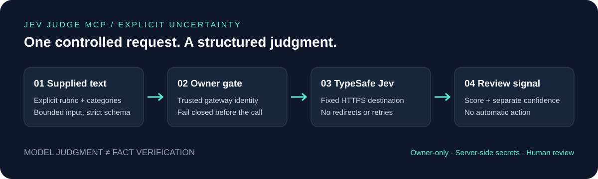

<div align="center">

# Private Jev

**Turn a vague AI opinion into a structured judgment you can inspect.**

[](src/domain.ts)
[](#tools)
[](#credits)
[](docs/architecture.md#the-authentication-boundary)

<br>

[See an example](#a-judgment-you-can-read) · [Try it offline](#try-it-offline) · [Architecture](docs/architecture.md) · [Security](SECURITY.md) · [Evidence](#what-is-verified)

</div>

<br>



---

## Why this exists

“Is this relevant?” is easy to ask a chatbot. It is harder to turn the answer into something another system can use **without silently treating the model's confidence as truth**.

Private Jev lets an assistant submit text with explicit questions and receive typed scores, categories, or yes/no probabilities. It keeps the rubric, uncertainty, and review flag visible. It does not decide what happens next.

**The project is the integration, not the model.** Nehal Swami directed this owner-private application, with AI-assisted implementation. TypeSafe provides Jev. The engineering here is the boundary around the model: authorization, validation, transport controls, normalized results, and honest failure behavior.

### A useful fit—and a deliberate boundary

| Use it to assist with | Do not mistake it for |
| --- | --- |
| Rank article or product ideas against your rubric | A browser or independent fact checker |
| Categorize a supplied support message | An automatic refund, escalation, or ticket action |
| Score a lead against supplied qualification criteria | Verified facts about the person or company |
| Surface uncertainty for a reviewer | Calibrated accuracy or permission to act |

## A judgment you can read

Take a **synthetic** support ticket about a duplicate charge. Ask for impact, category, and whether it explicitly requests a refund.

The existing offline test fixture produces this **mock result—not a live model answer**:

| Question | Result | Uncertainty | Review? |
| --- | --- | --- | --- |
| Impact | **75/100**; raw **1.5** on a 0–2 rubric | Provider fixture confidence **0.69** | Yes |
| Category | **billing** | Provider fixture confidence **0.90** | No |
| Refund requested? | Yes probability **0.50** | `confidence: null` by design | Yes |

The overall response has `needs_review: true` and `verification_status: "not_fact_checked"`.

**75/100 is the rubric score, not a 75% probability that the answer is correct.** A high category confidence also does not override the other questions' review flags. These values demonstrate response handling, not model quality.

→ **[Complete request, generated mock response, and a copy-paste offline replay](docs/examples.md)**

## Try it offline

Requires Node **22.13+**; this export was checked on **24.22.1**. Access to this private repository is required to clone it.

```bash
git clone https://github.com/swami8791/private-jev.git
cd private-jev
npm test
```

Expected: **100 passing offline tests**. This command needs no dependency installation, account, or API key after cloning; provider calls are injected mocks. The [offline replay](docs/examples.md#replay-it-without-a-key) then shows a complete result using the real service code.

### Full application development

```bash
npm ci
npm run typecheck
npm run build
npm run test:worker
```

These are the repository's full-development commands, not a claim that a fresh framework build was rerun for this documentation update. Worker tests need build output and local loopback sockets. Sites/Vinext tooling and the appropriate hosting environment are required for application deployment.

### Connecting a live instance is a separate step

[`.env.example`](.env.example) documents `TYPESAFE_API_KEY` and `JEV_OWNER_SITE_USER_ID` with empty values. Actual values belong in native server-side runtime/secret settings, never Git or a client bundle. Live evaluation can consume TypeSafe credits.

The export intentionally omits the original private Site project ID. It has no automatic deployment wiring. Review the [authentication and hosting prerequisites](docs/architecture.md#the-authentication-boundary) before associating it with any Site. **Do not expose the Worker directly and trust user-supplied identity headers.**

## Tools

| Tool | Contract |
| --- | --- |
| `jev_status({})` | Configuration presence and the caller's own Site-scoped identity. **No TypeSafe request.** |
| `jev_evaluate({ state, questions, sources? })` | Owner-only model judgment; one fixed provider request after validation. No automatic retries or downstream actions. |

Question types: `score`, `choice`, and `noul`. The adapter exposes `server/discover`, `tools/list`, and `tools/call`, declaring MCP version `2026-07-28`; compatibility with every client is not claimed.

## Engineering decisions that matter

- **Fail closed first.** Missing identity, wrong owner, missing configuration, or invalid input stops evaluation before the provider call.
- **One destination, one attempt.** Fixed HTTPS endpoint, redirects rejected, no automatic retry, 20-second deadline.
- **Validate both sides.** Input and output are bounded; malformed responses become explicit sanitized errors rather than partial answers.
- **Keep signals separate.** Scores, native confidence, provisional review flags, and fact-verification status are different fields.
- **Do not turn links into evidence.** Optional sources are echoed as unverified metadata; they are not fetched or forwarded to the provider.

→ **[Architecture, trust boundaries, data flow, and tradeoffs](docs/architecture.md)**

## What is verified

| Evidence | What it establishes | What it does not establish |
| --- | --- | --- |
| **100 offline tests**, rerun October 31, 2026 | Core validation, authorization, transport handling, and MCP behavior against fixtures | Live provider availability or judgment quality |
| **Five offline Worker tests**, historical October 25 record | Transport regression coverage in the Worker runtime at the baseline | A fresh full-framework build of this export |
| **One approved synthetic live evaluation**, historical October 25 record | The deployed assistant → MCP → TypeSafe flow worked at that time | Broad accuracy, calibrated confidence, or suitability for high-stakes decisions |

The example in this README is generated from the **mock fixture**, not the historical live test. No live request was made for this GitHub export or its documentation improvements.

## Read the project

| Start here | Then go deeper |
| --- | --- |
| [Examples](docs/examples.md): request → response → interpretation | [`tests/fixtures.mjs`](tests/fixtures.mjs), [`tests/service.test.mjs`](tests/service.test.mjs) |
| [Architecture](docs/architecture.md): boundaries and design decisions | [`src/domain.ts`](src/domain.ts), [`src/service.ts`](src/service.ts), [`src/mcp.ts`](src/mcp.ts), [`worker/index.ts`](worker/index.ts) |
| [Security](SECURITY.md): secrets and deployment constraints | [Transport diagnosis](docs/transport-diagnosis.md) |
| [Source provenance](docs/source-provenance.md): export baseline and hygiene | [Historical verification log](docs/verification.md) |

Historical development notes describe intermediate states. Their early “not deployed” statements are not a current deployment-status claim.

## Limits worth keeping visible

Review thresholds are provisional, not validated risk policies. No independent source verification, autonomous actions, training, or application payload storage is implemented. Provider retention and data handling are separate from the application's behavior. Assess those before supplying sensitive or regulated data. Do not use this integration alone to authorize clinical, legal, financial, or other consequential decisions.

## Credits

- **Nehal Swami:** project direction and the Private Jev integration concept.
- **OpenAI ChatGPT/Codex:** AI assistance with implementation and documentation; not a claim of entirely manual authorship.
- **TypeSafe:** underlying Jev model and API; no model authorship or training is claimed by this project.
- **Upstream tooling:** Sites/Vinext, Cloudflare, React, shadcn, and other dependencies. Existing vendored license notices are retained; no blanket open-source license is added by this private export.

---

<div align="center">

**A judgment is a signal—not a fact, and not permission to act.**

</div>
