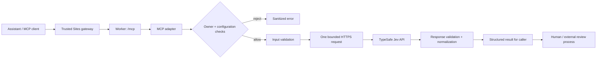

# Architecture & trust boundaries

[← Project overview](../README.md) · [Runnable example](examples.md) · [Security](../SECURITY.md)

Private Jev wraps a third-party model with a small, owner-restricted interface. It is not a model-training system and does not independently establish whether supplied text is true.

## The system at a glance

The final review process is **outside this application**. The integration returns a review flag; it does not operate a review queue or execute an action.

## What belongs to whom

| Layer | Responsibility |
| --- | --- |
| Private Jev integration, directed by Nehal Swami with AI assistance | MCP adapter, owner checks, input/output contracts, bounded transport, normalization, review flags |
| TypeSafe Jev | Model inference and native model-reported values |
| Sites gateway / hosting platform | Trusted identity context, access enforcement at the hosting boundary, runtime secret injection |
| User and any downstream system | Decide which data may be sent and how results should be reviewed or used |

This is a responsibility map, not a legal ownership determination or an assurance about provider behavior.

## The authentication boundary

`src/mcp.ts` takes caller identity from `oai-authenticated-user-id`. **The code does not authenticate that header itself.** It must be mounted behind the trusted Sites gateway, which supplies the identity context. A caller-controlled header on a public direct origin would undermine the intended trust model.

`createJev` then checks:

1. A trusted caller identity is present.
2. An owner identity is configured.
3. The caller equals that configured owner.
4. A provider key is configured.
5. The submitted evaluation passes strict validation.

Only then may it contact TypeSafe. `jev_status` is intentionally different: it reports configuration presence and the caller's own identity without contacting the provider. Configuration presence does not prove a key is valid upstream.

For a live instance, hosting access policy, gateway identity behavior, exact owner mapping, and secret configuration must all be verified. The repository export omits the original project ID to avoid accidental targeting of the existing Site. Cloning this repository does not configure authentication or authorize deployment.

## What crosses the provider boundary

| Data | Sent to TypeSafe? | Returned to caller? |
| --- | --- | --- |
| Supplied `state` | Yes | Not echoed as a top-level result field |
| `questions`, instructions, and criteria | Yes | Criteria are included in normalized answers |
| Pinned model (`jev-1.14.0`) | Yes | Requested and returned model identifiers |
| API key | Authorization header, server-side | Never intentionally echoed |
| Owner identity / MCP `_meta` | No | Caller identity is available through status only |
| Optional `sources` | No; never fetched | Echoed with `verification_status: "unverified"` |

The endpoint is fixed to `https://api.typesafe.ai/v1/systemone`. No arbitrary destination or source URL is fetched. The app does not implement payload persistence or logging; that does not establish the provider's retention policy.

## Boundaries in code

| Control | Current behavior | Code |
| --- | --- | --- |
| Input envelope | 32 KiB maximum, strict allowed fields | `src/mcp.ts`, `src/domain.ts` |
| Supplied text | 16 KiB UTF-8 maximum | `parseInput` |
| Questions | 1–8, explicit allowed question types | `parseInput` |
| Response | 128 KiB maximum, strict schema and numeric bounds | `readCapped`, `validateAnswers` |
| Time | 20-second deadline for headers and body | `createJev` |
| Redirects | Manual mode; non-OK response rejected, destination never followed | `createJev` |
| Retries | None automatically | `createJev` |
| Errors | Stable codes; raw provider bodies are not echoed | `providerCode`, MCP error handling |

Examples of explicit failures: `UNAUTHORIZED`, `FORBIDDEN`, `NOT_CONFIGURED`, `INVALID_INPUT`, `PROVIDER_AUTH`, `PROVIDER_BUSY`, `MALFORMED_RESPONSE`, and `TIMEOUT`. An error is not a low-confidence answer. The caller must handle it separately.

## Judgment is not verification

For `score`, normalization is `raw_score / (rubric_levels - 1)`. The result keeps the original raw range. Confidence is a separate model-reported field.

For `choice`, confidence below `0.70` or category `uncertain` sets review. For `score`, confidence below `0.70` sets review. For `noul`, probability strictly between `0.20` and `0.80` sets review, and confidence remains `null`. The overall review flag is true if any answer needs review.

These are **provisional heuristics**, not calibrated error guarantees. A result always says `not_fact_checked`. The response records the returned model identifier but does not require it to equal the requested identifier; downstream consumers should inspect both if exact version identity is important.

## Why this shape

- **Narrow tools over an agent framework:** the integration evaluates supplied content; it does not need orchestration or autonomous execution.
- **No retries over hidden convenience:** one attempt keeps provider usage predictable and makes failures visible. A retry is a new caller decision.
- **Strict responses over partial success:** malformed or unexpected shapes are rejected, not repaired by guessing.
- **Owner-only over multi-tenant generalization:** the design serves a single configured owner. It does not implement tenant administration or per-user billing.
- **Separate confidence and truth labels:** the API makes it harder to accidentally present a model judgment as verified evidence, without claiming that labels eliminate misuse.

## What this does not add

No rate limiter, durable audit log, human-review queue, model evaluation benchmark, calibrated confidence layer, or automatic deployment is implemented here. Those are explicit gaps to evaluate before a broader rollout—not implied capabilities of the current code.
